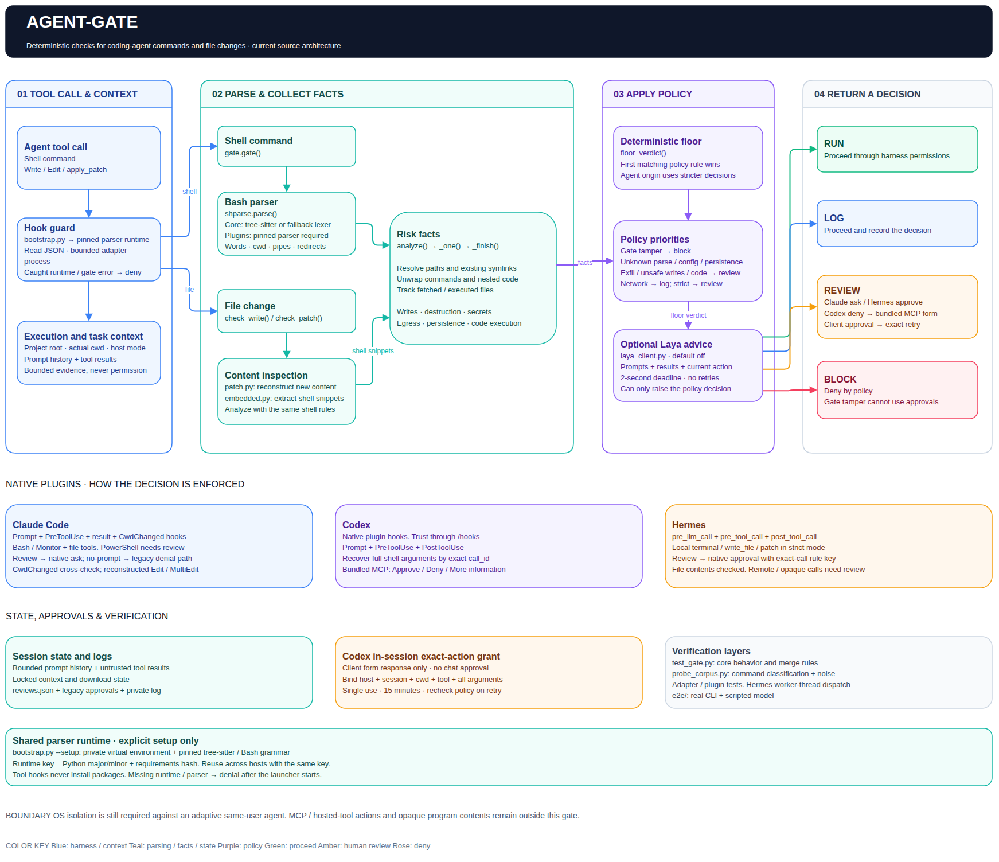
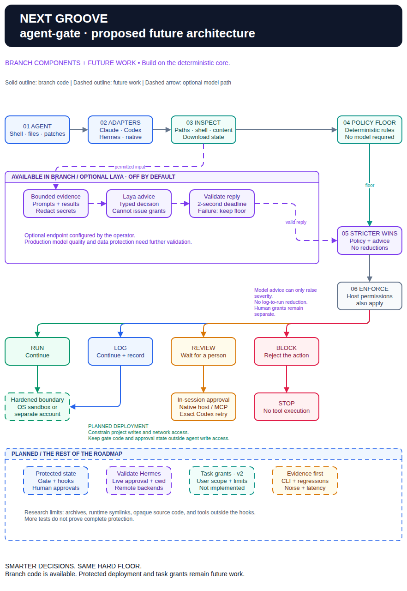

# 🪩 agent-gate

**More groove. Less host damage.**

agent-gate examines commands and file changes before an AI agent uses a supported tool.
It provides native plugins for Claude Code, Codex, and Hermes.
The deterministic policy works without a model.

## What it does

- Examines Bash commands, paths, symlinks that are present, and known network actions.
- Finds recognized secret transfers, unsafe writes, downloads, and persistent changes.
- Examines shell code inside supported scripts, package files, CI files, and patches.
- Tracks downloaded files across calls and protects recognized access to gate code and state.
- Keeps bounded prompt history and tool results as evidence, not permission.
- Gets human approval in the same host session. Codex uses a bundled MCP server.
- Adds optional Laya advice. A model cannot lower the deterministic decision.

| Decision | Effect |
|---|---|
| 🟩 `run` | Continue through host permissions. |
| 🟦 `log` | Record the decision and continue through host permissions. |
| 🟧 `review` | Get human approval. |
| 🟥 `block` | Reject the action. One-time approval cannot override it. |

CAUTION: Use an OS sandbox or a separate user account.
The gate is not an isolation boundary.
It cannot examine every tool or opaque program.
An agent with your account can alter hooks or forge approval state outside the gate's analysis.

## Current architecture

The native hooks use a shared parser runtime and the deterministic policy.
The adapters apply the decision before tool execution.
Prompt and result hooks keep context for the next action.
Laya stays off unless the operator configures an endpoint.



[Editable draw.io file](docs/diagrams/agent-gate-architecture.drawio) · [Vector preview](docs/diagrams/agent-gate-architecture.drawio.svg)

## Quick start

Use Python 3.11 or later with `venv` and `pip`.
Make sure that `python3` starts this Python installation on the host PATH.
Git is necessary for installation from GitHub.
Do not combine a native plugin with manual hooks for the same host.

### Claude Code

Run these commands in Claude Code:

```text
/plugin marketplace add subhashdasyam/agent-gate
/plugin install agent-gate@agent-gate
```

### Codex

Run these commands in your terminal:

```bash
codex plugin marketplace add https://github.com/subhashdasyam/agent-gate.git
codex plugin add agent-gate@agent-gate
```

Use `/hooks` in Codex to examine and trust the hook definition.
Installation alone does not establish hook trust.

Keep Code Mode enabled. No disable flags are necessary.
After runtime setup, ask Agent Gate to call `check_review_support` once in Codex.
This form check runs no command and creates no grant.
If no form appears, refer to [Codex review forms](docs/integrations.md#codex-review-forms).

The execution guard checks the actual directory before the original command runs.
Linux and macOS use Bash. Native Windows uses PowerShell with conservative policy checks.
Refer to [the execution guard](docs/execution-guard.md) for scope and validation limits.

### Hermes

Run this command in your terminal:

```bash
hermes plugins install subhashdasyam/agent-gate --enable
```

The plugin supports Hermes `0.21.2` or later.

### Prepare the parser

Run the exact setup command from the gate's denial in your own terminal.
The installed path and Python version can differ between hosts.
For a checkout, use:

```bash
python3 adapters/bootstrap.py --setup --mcp
python3 adapters/bootstrap.py --doctor --mcp
```

Only explicit setup downloads packages.
Tool hooks never install dependencies.
The `--mcp` option prepares Codex approvals. Claude and Hermes need only `--setup`.
Restart the host after setup.
Confirm that the plugin and hooks are active.

Refer to [installation and approvals](docs/integrations.md) for local development, manual migration, configuration, and fault checks.

## Future state

The optional Laya client is available in this branch, with a 2-second deadline.
Production validation, protected deployment, and bounded task grants remain future work.



[Editable draw.io file](docs/diagrams/agent-gate-future-state.drawio) · [Vector preview](docs/diagrams/agent-gate-future-state.drawio.svg)

Solid outlines show available components. Dashed outlines show future work.
Claude and Hermes interactive validation and remote-backend checks remain future work.
Refer to the [complete roadmap and Laya TODOs](docs/roadmap.md).

## Technical documentation

[Documentation index](docs/README.md) · [Context and approvals](docs/context-and-approvals.md) · [Policy and API](docs/policy-and-api.md) · [Tests and limits](docs/testing-and-limits.md)

Codex `0.162.1` passed native form and bundled-server checks in isolated test profiles.
Scripted responses test the transport, not real human consent.
The pinned-parser corpus caught 318/318 attack probes. This does not prove complete protection.
Refer to the [dated evidence and test limits](docs/testing-and-limits.md).

## License

Free personal and noncommercial use, modification, and redistribution are permitted under the [Agent Gate Personal and Noncommercial License 1.0](LICENSE).
Distributed copies must retain the [credit notice](NOTICE) for Subhash Dasyam and identify any modifications.
Commercial use, paid services, resale, and commercial redistribution require separate written permission from Subhash Dasyam.
Credit alone does not grant commercial permission.

This is source-available software, not MIT-licensed or OSI-approved open source.
Third-party software retains its own licenses.
